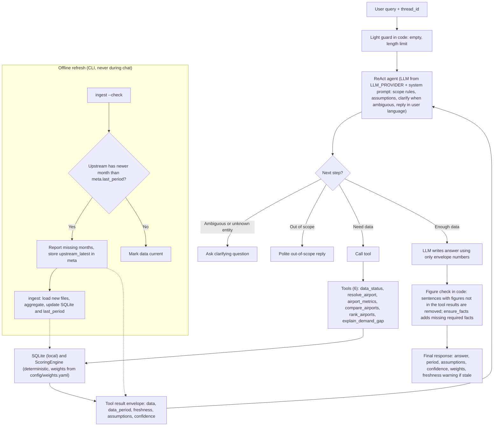

# Airport Investment Intelligence Agent

A conversational agent that helps an analyst find US airports where renovation or terminal expansion is most likely to pay off, judged by passenger and flight capacity pressure. The model understands the question and picks tools; every number, ranking and verdict comes from SQL and a deterministic scoring module. Built as a 24-hour take-home for a Deloitte Digital Forward Deployed Engineer role.

Design doc: [docs/design.md](docs/design.md) (methodology, tradeoffs, the four answers). Build plan and definitions: [docs/plan.md](docs/plan.md). Task board and decision log: [TASKS.md](TASKS.md).

## What it answers
1. Which airports in New England are strong candidates for terminal expansion? (ranking with the weights used, drivers and rank stability)
2. Compare LA (LAX) and Santa Ana (SNA) congestion. (side by side, with margins of error and a verdict per measure)
3. What share of flights out of Anchorage is long haul? (all flights including cargo, and passenger service only, with a distance sensitivity)
4. What is the unmet flight demand at SFO and why? (a labeled proxy: unmet demand is not observable in public data)

Follow-up questions work in the same chat ("what if growth weighs more?", "which of these has the highest load factor?"). Each answer shows the data card rendered from the tool results first, then the model's commentary, labeled as such, and states the data period, assumptions, confidence, the weights used and whether newer data exists upstream.

## How it works
- **The LLM never computes numbers.** It chooses tools and phrases results. Metrics come from SQL (`src/store.py`, `src/tools.py`) and `src/scoring.py`; the card on screen is rendered by code (`src/render.py`).
- **Guardrails in code, not in the prompt.** Required facts missing from the commentary are appended (`ensure_facts`); commentary sentences with figures that are not in the tool results are removed (`src/figure_check.py`); rankings and comparisons get caveat-only commentary.
- **Offline data.** An idempotent `ingest` command loads BTS and Census data into a local SQLite DB. Nothing is fetched at chat time.
- **No hardcoded values.** Infrastructure and secrets come from `.env` ([.env.example](.env.example)); scoring methodology lives in [config/weights.yaml](config/weights.yaml). Both are read only through `src/config.py`.
- **Swappable model.** The model is a service chosen in `.env`: OpenAI for the quickstart, a local Ollama model or any OpenAI-compatible server for development (`LLM_PROVIDER`, `LLM_MODEL`, `LLM_BASE_URL`), with no code change.

## Architecture


## Request flow



## Quickstart
The data comes ready-made (see First start); you only provide the language model.

### Docker with OpenAI (recommended)
Set `OPENAI_API_KEY` in `.env`, then `docker compose up`:
```bash
cp .env.example .env
# in .env, fill in the one empty line:  OPENAI_API_KEY=sk-...
docker compose up --build
```
Open http://localhost:8501 (or the `APP_PORT` you set). `.env.example` already has `LLM_PROVIDER=openai` and `LLM_MODEL=gpt-4o-mini`; change `LLM_MODEL` for another OpenAI model. If the key is missing or wrong, or the model server cannot be reached, the app shows one line naming the setting to fix (`OPENAI_API_KEY`, `LLM_MODEL`, `LLM_BASE_URL`, `LLM_PROVIDER`).

One question from the command line, inside the running container:
```bash
docker compose exec app python -m src.agent "Compare LA and Santa Ana airport congestion levels."
```

### Local (uv)
```bash
cp .env.example .env              # same LLM settings as above
uv sync
uv run python -m src.bootstrap    # downloads the seed DB to data/airport.db (skipped if a valid DB is there)
uv run streamlit run app.py
```
The CLI equivalent is `uv run python -m src.agent "<question>"`.

### Optional: a local model (Ollama)
For development without an API key. The model runs in Ollama on the host, not in the container (the compose file has no Ollama service), and models come from the Ollama registry, not from Docker Hub or the image:
1. Install Ollama on the host and pull a model with tool calling, for example `ollama pull llama3.1`.
2. In `.env`: `LLM_PROVIDER=ollama`, `LLM_MODEL=llama3.1`, `LLM_BASE_URL=http://host.docker.internal:11434` (for a local `uv run`, `http://localhost:11434`), and remove or leave empty `OPENAI_API_KEY`. The commented lines in `.env.example` show these settings; `OLLAMA_NUM_CTX=16384` keeps follow-ups inside the context window.
3. Docker Desktop resolves `host.docker.internal`; on Linux the `extra_hosts` line in `docker-compose.yml` does, and Ollama must listen beyond localhost (`OLLAMA_HOST=0.0.0.0`).

On CPU only, local models are slow: one to four minutes per answer with 8-20B models on a laptop in our runs, and their commentary is less reliable (the data card is not affected). Any OpenAI-compatible server also works: `LLM_PROVIDER=openai` with `LLM_BASE_URL=http://host.docker.internal:11434/v1`.

## First start
The data is not in git or in the image. `src.bootstrap` (the container entrypoint, or the command above) checks `DB_PATH`; if the DB is missing or invalid it downloads the seed DB from `SEED_DB_URL` (a gzipped SQLite file published as a GitHub Release asset), verifies its sha256 and installs it atomically. Later starts reuse it (in Docker it lives in the `data` volume). It then runs `ingest --check` with a short timeout so the sidebar can say whether newer data exists upstream; offline, freshness is "unknown" and the app still starts. If no data can be obtained it stops with three options: set `SEED_DB_URL`, mount an existing `airport.db` at `/app/data/airport.db`, or build the DB with `ingest` from the raw files.

## Data sources
| Source | Used for |
|---|---|
| [BTS T-100 Segment, All Carriers](https://www.transtats.bts.gov/) | Departures, seats, passengers, distance, aircraft configuration (passenger vs cargo); the analysis window and the 12 months before it (growth) |
| [BTS Reporting Carrier On-Time Performance](https://www.transtats.bts.gov/) | Departure delays, taxi-out, cancellations, delay causes; domestic flights of the large reporting carriers only |
| [US Census Bureau Data API](https://www.census.gov/data/developers.html), ACS 5-year | Population of metro and micro areas (CBSAs); airport to CBSA via the Census Geocoder; vintages in `config/weights.yaml` (`census`) |
| [OurAirports](https://ourairports.com/data/) | Airport names, states, coordinates (public domain) |

One analysis window serves every question: the trailing 12 complete months ending at the latest month loaded for both BTS sources. The window is printed on every answer and in the sidebar; for the shipped seed it is 2025-01..2025-12.

This product uses the Census Bureau Data API but is not endorsed or certified by the Census Bureau. BTS data is public (US Department of Transportation, Bureau of Transportation Statistics).

## Scoring
Each component is a percentile among US airports in the peer set (a minimum number of passenger-service passengers in the window), so a score of 0.75 means "on average at the 75th percentile nationally". Airports are then ranked inside the requested region. The score is a capacity-pressure proxy, not a measured terminal need: public data has no gate or terminal-area figures. Weights, thresholds, the peer-set floor and the regions are in [config/weights.yaml](config/weights.yaml); definitions are in [docs/plan.md](docs/plan.md) (Definitions, Scoring); the reasoning is in [docs/design.md](docs/design.md).

| Component | Measures | Source |
|---|---|---|
| Utilization | Seat load factor on passenger service (passengers / seats): demand pressure, not terminal use | T-100 |
| Congestion | Departure-delay rate, mean taxi-out, NAS-delay minutes per arriving flight (cancellations shown, not scored) | On-Time |
| Scale | Annual passengers: keeps the ranking about volume, not only pressure | T-100 |
| Growth | Passenger growth, window vs the previous 12 months | T-100 |
| Long haul | Share of passenger-service departures at or above the long-haul distance threshold | T-100 |
| Demand context | Population growth of the metro or micro area (CBSA) the airport lies in | Census |

A missing component (no On-Time coverage, no CBSA) renormalizes the remaining weights for that airport and lowers its confidence. Every ranking also reports rank stability: how often each airport stays near the top when the weights are perturbed at random (seeded, so the same question gives the same card). `rank_airports` accepts scenario weights ("what if growth weighs more?"), applied by the scoring code, not by the model.

## Testing and evaluation
- `uv run pytest`: unit and golden tests, no model and no network (CI runs them and a `docker build` on every push to `main` and every pull request). The golden tests (`tests/test_golden.py`) put the four exam questions and the edge cases (unknown airport, unsupported region, scenario weights, ambiguity) through the tools on a small fixture DB; agent tests use a scripted fake model.
- `uv run ruff check`: lint.
- `uv run python scripts/eval.py`: the eval harness and model-comparison tool. It asks the questions in [eval/questions.yaml](eval/questions.yaml) (the four exam questions, follow-ups in one conversation, single airports, an unknown airport, an unsupported region, an out-of-scope question and a prompt-injection attempt) to the real agent with the model set in `.env`, and checks per question: tools called (and their arguments) vs expected, must-have facts, forbidden text in what the user sees (the rendered cards and the commentary after the figure check), the commentary figure check, an empty or cut-off reply, and the time taken; every failed question gets a reason. Results are appended to `eval/results/<timestamp>-<model>.jsonl` (not committed) and a markdown table is printed. `--only q3_anchorage_long_haul,q4_sfo_unmet_demand` runs some questions; `--report <file>.jsonl` re-prints a saved run. Not in CI: it needs a model and the real DB.

## Updating the data
Ingest runs offline, never during a chat, and is idempotent (a month already loaded is skipped; a changed On-Time file reloads its month only).
```bash
uv run python -m src.ingest           # load the files in RAW_DATA_DIR (default data/raw) into DB_PATH
uv run python -m src.ingest --check   # ask upstream for its latest period per source; no downloads
```
Raw files: T-100 exports as `data/raw/t100_segment/t100*.csv`, On-Time monthly TranStats downloads as `data/raw/ontime/**/ontime_*.zip`, OurAirports as `data/raw/airports.csv`; Census needs `CENSUS_API_KEY` in `.env`. Downloading new BTS months is manual for now (see Known limits).

Freshness, per source and overall, from the last `--check` (stored in the DB, shown in the sidebar and in every answer):
- **fresh**: upstream has nothing newer than the loaded period.
- **stale (upstream has YYYY-MM)**: a newer month exists; answers still use the loaded data and say so. The shipped seed is stale on purpose: it holds a complete calendar year, and BTS has published later months since.
- **unknown**: never checked, or the check could not reach upstream.

## Known limits
- The score is a capacity-pressure proxy: load factor and delays show where demand presses, not how much terminal space is missing.
- "Unmet demand" is a labeled proxy (passengers above a target load level per route and month, with a range), never an observed value: there is no booking or spill data.
- On-Time covers domestic flights of the large reporting carriers only; airports with few reported flights are scored without congestion (lower confidence). On-Time figures carry margins of error; T-100 figures are full counts.
- Cargo-heavy airports such as ANC need passenger-service and all-flights figures side by side; the tools always give both.
- Percentiles are relative to the peer set, and the passenger floor that defines it is a policy line (airports just under it are listed as excluded, with the reason).
- New BTS months are loaded from files downloaded by hand; `ingest --check` reports when upstream is ahead. Automated download is a next step ([docs/design.md](docs/design.md)).
- The chat UI is in English; answers follow the language of the question.

## Maintainers: publishing a new seed DB
The seed DB is a GitHub Release asset, not a file in git. Each data version gets its own release tag, so an old URL keeps serving the data it was published with.
1. Refresh the data: `uv run python -m src.ingest` (raw files in `data/raw`), then `uv run python -m src.ingest --check`.
2. Rebuild the seed: `uv run python -m src.seed build` writes `data/seed/airport.db.gz` and `airport.db.gz.sha256` and prints the sizes (it stops above `SEED_MAX_MB`).
3. Publish a new release with both files (new tag, e.g. `data-2026-07`):
   ```bash
   gh release create data-2026-07 data/seed/airport.db.gz data/seed/airport.db.gz.sha256 \
     --title "Seed data 2026-07" --notes "Aggregated SQLite seed DB, window ending 2026-07. sha256 in airport.db.gz.sha256."
   ```
4. Point `SEED_DB_URL` in `.env.example` to `https://github.com/<owner>/<repo>/releases/download/<tag>/airport.db.gz` and commit. Existing volumes keep their DB until it is invalid (bump `store.SCHEMA_VERSION` when the schema changes) or the volume is removed (`docker compose down -v`).

## Project layout
```
app.py      Streamlit chat (data from tools first, model commentary second)
Dockerfile, docker-compose.yml, docker/   container image, one-service compose, entrypoint
src/        config, LLM provider registry, ingest and upstream check, Census, store, scoring,
            tools, render, figure check, agent (also the CLI), seed build, bootstrap
config/     scoring methodology (weights.yaml)
docs/       design.md (design doc), plan.md (build plan and definitions)
tests/      unit and golden tests (CI)
eval/       eval questions; results/ (not committed) from scripts/eval.py
scripts/    eval.py (eval harness, model comparison)
data/       raw downloads, airport.db, seed/ (built seed DB); not committed
```
