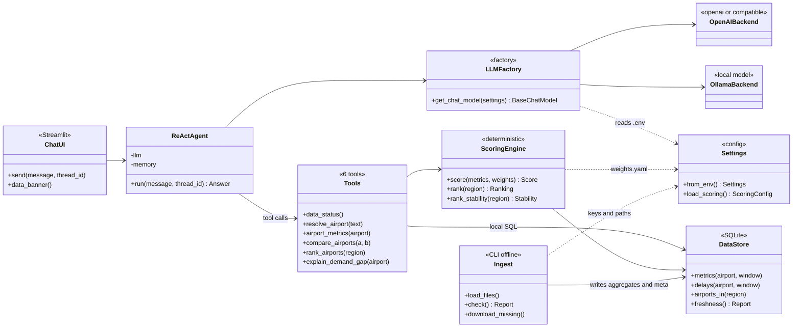
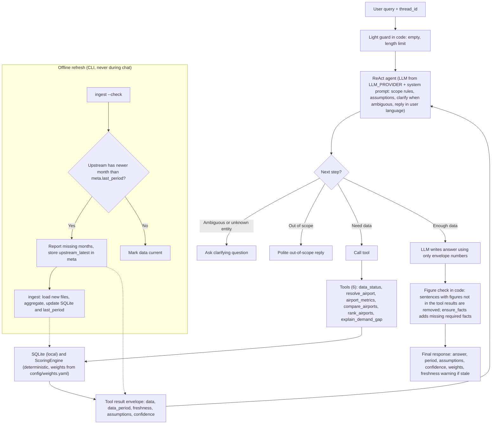

# Airport Investment Intelligence Agent

A conversational agent that helps an analyst find US airports where renovation or terminal expansion is most likely to pay off, based on passenger and flight capacity pressure. Built as a 24-hour take-home for a Deloitte Digital Forward Deployed Engineer role.

> **Status: work in progress.** The task board is in [TASKS.md](TASKS.md). Design details are in [docs/plan.md](docs/plan.md).

## What it answers
- Which airports in New England are strong candidates for terminal expansion?
- Compare LA (LAX) and Santa Ana (SNA) airport congestion levels.
- What is the percentage of long-haul flights out of Anchorage, with and without cargo?
- What is the unmet flight demand at SFO and why? (a stated proxy, not a measured field)

Follow-up questions work in the same chat.

## How it works
- **The LLM never computes numbers.** It chooses tools and phrases results. Every metric comes from SQL and a deterministic scoring module (`src/scoring.py`).
- **Every answer states** the data period, assumptions, confidence, the weights used and whether the data is current.
- **Data is loaded offline** into a local SQLite database by an idempotent `ingest` command. Nothing is fetched at chat time, so answers are fast and reproducible.
- **No hardcoded values.** Infrastructure and secrets come from `.env` ([.env.example](.env.example)); scoring methodology lives in [config/weights.yaml](config/weights.yaml). Both are read through `src/config.py`.
- **Swappable model.** `LLM_PROVIDER` selects OpenAI (or any OpenAI-compatible server) or a local Ollama model, with no code changes.

## Architecture



## Request flow



## Scoring
Each component is a percentile against all US passenger airports with at least 100,000 passenger-service passengers in the window. Airports are then ranked inside the requested region. A missing component renormalizes the weights and lowers the reported confidence.

| Component | Weight | Signal |
|---|---|---|
| Utilization | 0.25 | Seat load factor on passenger service (demand-pressure proxy) |
| Congestion | 0.25 | Departure-delay rate, taxi-out time, NAS-delay minutes per arriving flight |
| Scale | 0.15 | Annual passengers: keeps the ranking about money, not only pressure |
| Growth | 0.15 | Passenger growth, window vs the previous 12 months |
| Long haul | 0.10 | Share of departures at or above the distance threshold (2,500 mi by default) |
| Demand context | 0.10 | Metro-area population growth (Census) |

Weights and thresholds are editable in `config/weights.yaml`. The ranking also reports how stable it is when the weights are perturbed.

## Data sources
- BTS T-100 Segment (All Carriers): departures, seats, passengers, distance.
- BTS On-Time Reporting: delays, taxi-out, delay causes (domestic, large carriers only).
- Census Bureau Data API: metro-area population.
- OurAirports: airport names, states and coordinates.

## Quickstart
Available now:
```bash
cp .env.example .env     # choose LLM_PROVIDER and add a key, or point to a local model
uv sync
uv run pytest
```
Chat UI (needs the database: raw T-100 files and `airports.csv` in `data/raw`, loaded by ingest):
```bash
uv run python -m src.ingest      # builds data/airport.db (idempotent)
uv run streamlit run app.py
```
Each answer shows the figures from the data tools first, then the model's commentary.

### Docker
```bash
cp .env.example .env     # choose the LLM (below); SEED_DB_URL already points to the seed release
docker compose up --build
```
Then open http://localhost:8501 (`APP_PORT` in `.env`). The data is not in git or in the image: on first start the entrypoint (`python -m src.bootstrap`) downloads the seed DB from `SEED_DB_URL` (a GitHub Release asset), checks its sha256 and installs it in the `data` volume; later starts reuse it. It then runs `ingest --check` with a short timeout, so the sidebar can say whether newer data exists upstream (offline = "freshness unknown"; the app still starts). If no data can be obtained it stops with three options: set `SEED_DB_URL`, mount an existing `airport.db` at `/app/data/airport.db`, or run `uv run python -m src.ingest` with the raw files.

LLM from the container, set in `.env` (there is no Ollama service in the compose file):
- OpenAI: `LLM_PROVIDER=openai`, `LLM_MODEL=gpt-4o-mini`, `OPENAI_API_KEY=...`
- Ollama on the host: `LLM_PROVIDER=ollama`, `OLLAMA_BASE_URL=http://host.docker.internal:11434` (or `LLM_PROVIDER=openai` with `LLM_BASE_URL=http://host.docker.internal:11434/v1`). Docker Desktop resolves `host.docker.internal`; on Linux the `extra_hosts: host.docker.internal:host-gateway` line in `docker-compose.yml` does. Ollama must listen beyond localhost (`OLLAMA_HOST=0.0.0.0`) for the container to reach it on Linux.

## Testing
- `uv run pytest`: unit and golden tests, no model and no network (CI runs them on every push). The golden tests (`tests/test_golden.py`) put the four exam questions and the edge cases (unknown airport, unsupported region, scenario weights, ambiguity) through the agent's tools on a small fixture database; agent tests use a scripted fake model.
- `uv run python scripts/eval.py`: the eval harness, and the model-comparison tool. It asks the questions in [eval/questions.yaml](eval/questions.yaml) (the four exam questions, follow-ups in one conversation, single airports, an unknown airport, an unsupported region, an out-of-scope question and a prompt-injection attempt) to the real agent with the model set in `.env`, and checks per question: the tools called against the expected ones, the must-have facts, the commentary figure check, an empty or cut-off reply, and the time taken. To compare models, change `LLM_PROVIDER` / `LLM_MODEL` in `.env` and run it again. Each answer is appended to `eval/results/<timestamp>-<model>.jsonl` as soon as it is done (a stopped run keeps its results; the folder is not committed), and a markdown table is printed at the end.
  - `--only q3_anchorage_long_haul,q4_sfo_unmet_demand` runs some questions; `--out-dir` changes the folder; `--report eval/results/<file>.jsonl` re-prints the table of a saved run.
  - Not run in CI: it needs a model and the real database, and a local model takes minutes per question.

## Project layout
```
app.py      Streamlit chat (data from tools first, model commentary second)
Dockerfile, docker-compose.yml, docker/   container image, one-service compose, entrypoint
src/        config, LLM provider registry, ingest, store, scoring, tools, render, agent
config/     scoring methodology (weights.yaml)
docs/       design plan (and later design.md)
tests/      unit and golden tests (CI)
eval/       eval questions; results/ (not committed) from scripts/eval.py
scripts/    eval.py (eval harness, model comparison)
data/       raw downloads, airport.db, seed/ (built seed DB); not committed
```

## Limits
- Load factor is a demand-pressure proxy, not terminal utilization: public sources have no gate or terminal-area data.
- "Unmet demand" is a labeled proxy (passengers above a target load level: the excess over target x seats, per route and month), never an observed value: the data has no booking or spill records.
- On-Time covers domestic flights of large carriers only, so some small airports have partial coverage.
- Cargo-heavy airports such as ANC need passenger-only and all-flights numbers side by side.

## Attribution
This product uses the Census Bureau Data API but is not endorsed or certified by the Census Bureau.
